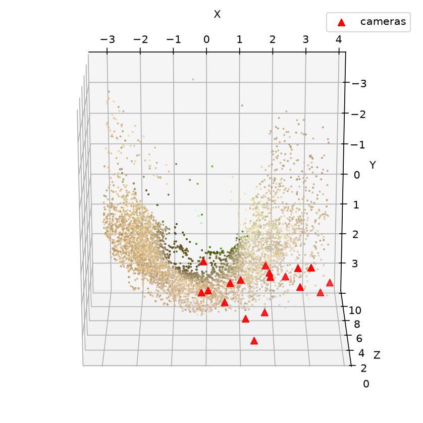
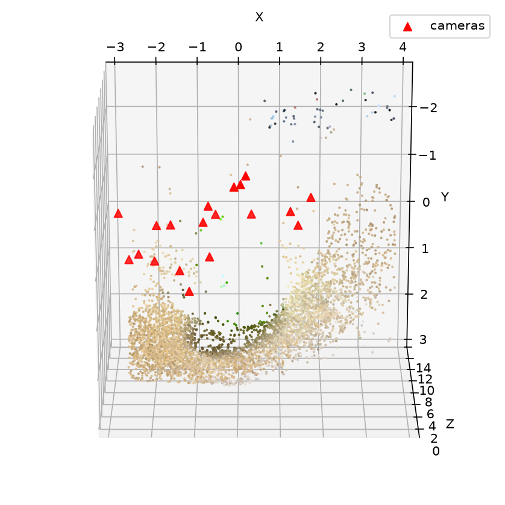
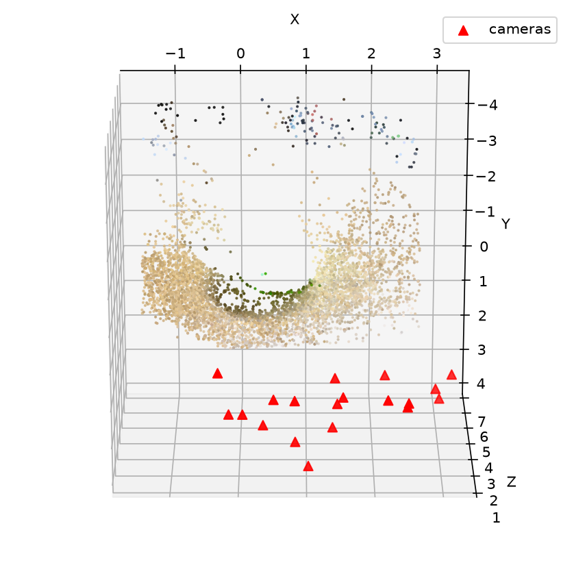

# Real-data results

## Desk dataset

The dataset contains 19 photos in `images/`. The reported run registered all 19 images and reconstructed 5,954 sparse points. Mean reprojection error was 0.61 px; runtime was 195 s. The 960 px focal-length run is saved in `out_f960/` locally; the three saved plots below compare focal initializations of 800, 960, and 1,150 px.

| Dataset | Photos registered | Sparse points | Mean reprojection error | Runtime |
| --- | ---: | ---: | ---: | ---: |
| Desk (real photos) | 19/19 | 5,954 | 0.61 px | 195 s |

All three reconstructions show a bowl-shaped point cloud. The shape persists across the three focal initializations, so focal length alone did not remove it.

### Focal-length comparison plots

**Initial focal length: 800 px**

**Initial focal length: 960 px**

**Initial focal length: 1,150 px**

## COLMAP comparison

COLMAP 4.2.1 was run on the same 19 photos with one shared `SIMPLE_RADIAL` camera, CPU feature extraction/matching, high quality, and sparse reconstruction. The default camera model is `SIMPLE_RADIAL`, which estimates focal length and one radial-distortion parameter ([COLMAP FAQ](https://colmap.github.io/faq.html#which-camera-model-should-i-use)).

| Registered images | Sparse points | Mean reprojection error | Estimated focal | Estimated k1 | Runtime |
| ---: | ---: | ---: | ---: | ---: | ---: |
| 19/19 | 5,412 | 0.9794 px | 1,064.19 px | -0.02001 | about 98 s |

The COLMAP point cloud is also visibly bowl-shaped. That makes the photo capture pattern a more likely source of the distortion than the fixed-intrinsics camera model alone, though it does not prove the cause. Camera centres from our 960 px run and COLMAP align with RMSE 0.1537, or 1.28% of COLMAP's scene extent (19 common cameras).

