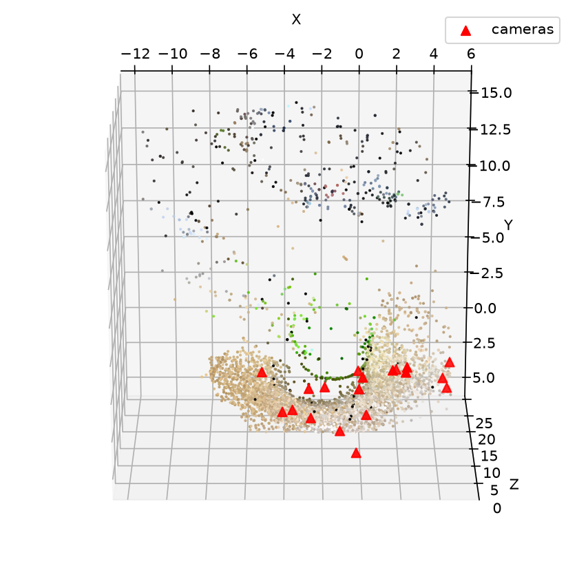
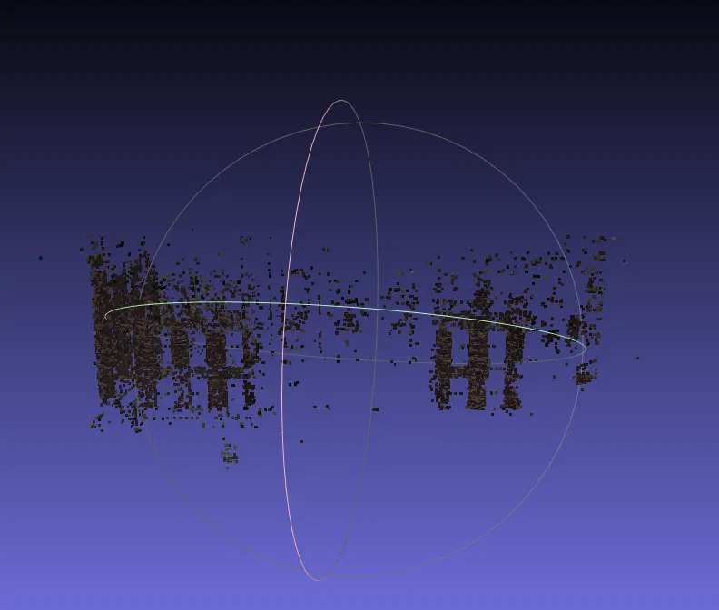
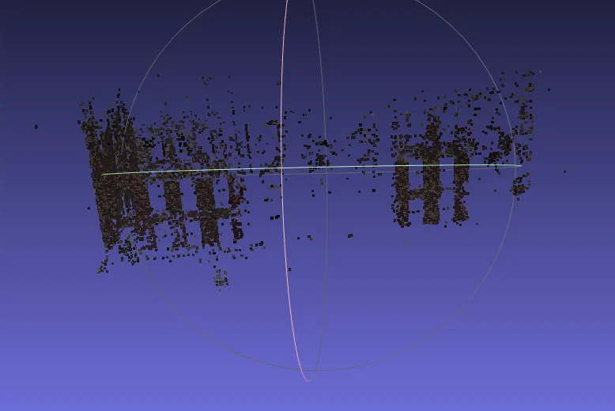
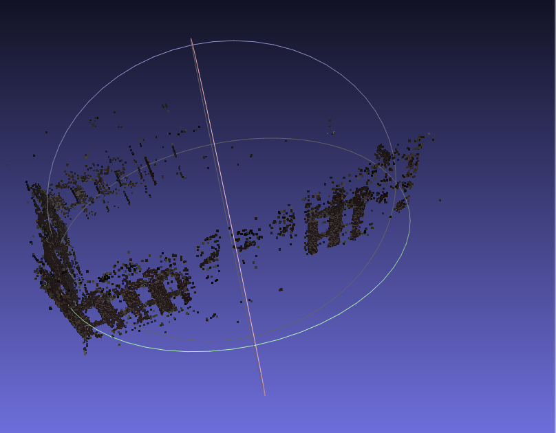
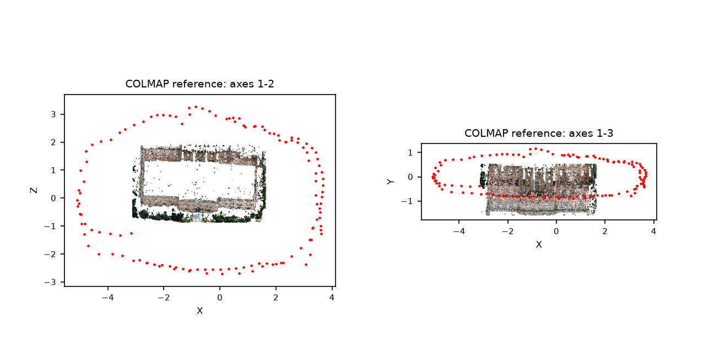

# Real-data results

## Desk dataset

The dataset contains 19 photos in `images/`. The reported run registered all 19 images and reconstructed 5,954 sparse points. Mean reprojection error was 0.61 px; runtime was 195 s. The 960 px focal-length run is saved in `out_f960/` locally; the three saved plots below compare focal initializations of 800, 960, and 1,150 px.

| Dataset | Photos registered | Sparse points | Mean reprojection error | Runtime |
| --- | ---: | ---: | ---: | ---: |
| Desk (real photos) | 19/19 | 5,954 | 0.61 px | 195 s |

All three reconstructions show a bowl-shaped point cloud. The shape persists across the three focal initializations, so focal length alone did not remove it.

### Focal-length comparison plots

**Initial focal length: 800 px**

**Initial focal length: 960 px**

**Initial focal length: 1,150 px**

## COLMAP comparison

COLMAP 4.2.1 was run on the same 19 photos with one shared `SIMPLE_RADIAL` camera, CPU feature extraction/matching, high quality, and sparse reconstruction. The default camera model is `SIMPLE_RADIAL`, which estimates focal length and one radial-distortion parameter ([COLMAP FAQ](https://colmap.github.io/faq.html#which-camera-model-should-i-use)).

| Registered images | Sparse points | Mean reprojection error | Estimated focal | Estimated k1 | Runtime |
| ---: | ---: | ---: | ---: | ---: | ---: |
| 19/19 | 5,412 | 0.9794 px | 1,064.19 px | -0.02001 | about 98 s |

The COLMAP point cloud is also visibly bowl-shaped. That makes the photo capture pattern a more likely source of the distortion than the fixed-intrinsics camera model alone, though it does not prove the cause. Camera centres from our 960 px run and COLMAP align with RMSE 0.1537, or 1.28% of COLMAP's scene extent (19 common cameras).

## South Building, attempt 1 (every 4th image, 6/32 registered)

Dataset source: [COLMAP datasets page](https://colmap.github.io/datasets.html), which lists 128 images of the South Building at UNC Chapel Hill. The supplied COLMAP sparse model is the reference for this comparison, not laser ground truth.

This run used 32 of the 128 images (every 4th image after sorting by filename), resized to a maximum dimension of 1600 px. The focal length was set to 1333 px after resizing, matching the supplied full-resolution focal length scaled to 1600 px.

Command: `python run_pipeline.py --images images_sb --out out_sb --focal 1333 --max_size 1600 --fast --window 4`

Final pipeline line: `Registered 6/32 images, 5893 3D points, mean reprojection error 0.12px, time 174s`

Measured wall runtime: 177.5 s. The run registered fewer than 25 images, so its comparison covers only the six cameras shared with the reference model.

| Common cameras | Camera-centre RMSE after alignment | RMSE as % of COLMAP scene extent |
| ---: | ---: | ---: |
| 6 | 0.0215 | 0.38% |

The low percentage describes camera-centre agreement for those six cameras after similarity alignment; it does not measure the accuracy of the reconstructed scene against physical ground truth.

## South Building, attempt 2 (every 2nd image from first 64; 24/32 registered)

This run used sorted image indices 0, 2, 4, ..., 62 from the first 64 source images (32 images total), with the same 1333 px focal length and 1600 px maximum image size.

Command: `python run_pipeline.py --images images_sb2 --out out_sb2 --focal 1333 --max_size 1600 --fast --window 6`

Final pipeline line: `Registered 24/32 images, 18898 3D points, mean reprojection error 0.15px, time 516s`

Measured wall runtime: 519.7 s. The eight images that did not register were `P1180141.JPG`, `P1180143.JPG`, `P1180145.JPG`, `P1180147.JPG`, `P1180149.JPG`, `P1180151.JPG`, `P1180153.JPG`, and `P1180155.JPG`.

| Common cameras | Camera-centre RMSE after alignment | RMSE as % of COLMAP scene extent |
| ---: | ---: | ---: |
| 24 | 0.0365 | 0.36% |

Full matching and PnP output is saved in `out_sb2/run.log`. `out_sb2/registration_diagnostics.txt` maps input indices to filenames and collects all pairwise matching lines involving the unregistered images, all accepted PnP inlier lines, and the final failed-index list. The pipeline did not emit PnP inlier lines for the images it failed to register. For example, pairs from unregistered indices 2–7 to the first accepted index 8 yielded 10, 11, 11, 55, 28, and 53 inliers respectively; these pair counts alone do not establish the failure cause.

### South Building point cloud in MeshLab

Screenshots of the South Building point cloud viewed in MeshLab:

### COLMAP reference model

This two-view plot is rendered from the supplied COLMAP `points3D.txt` and `images.txt`; red dots mark the 128 camera centers. Points outside the per-axis 2nd–98th percentile range are omitted for display so distant outliers do not set the plot scale.

### Flatness check (desk)
Plane-fit RMS as % of scene extent: f=960 -> 0.87%, f=1064 -> 0.67%
(COLMAP-estimated focal). Mean reprojection error 0.61 -> 0.50 px,
6,436 points, 19/19 registered, 165 s. The point clouds are close to
planar; the bowl appearance in the 3D plots is largely a viewing effect.
